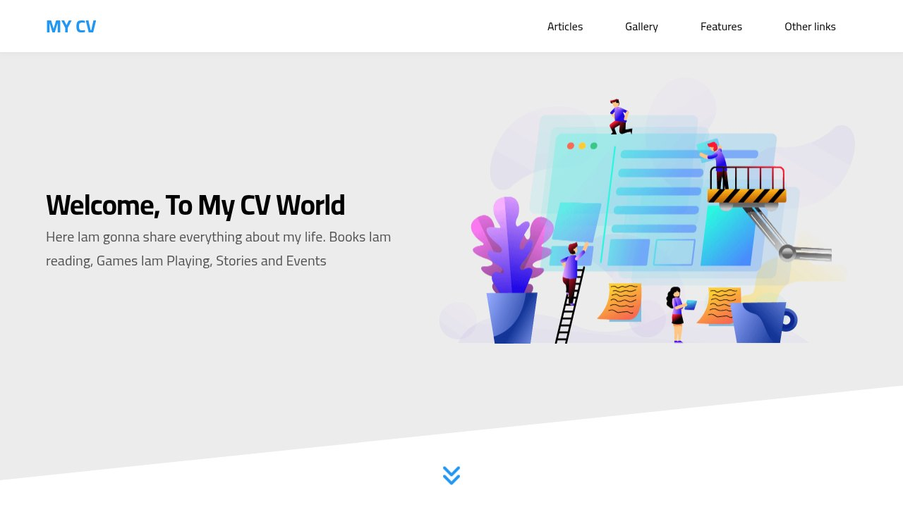

# Template Three

A multi-section website template in the style of a personal CV page: articles, gallery, features, testimonials, team, services, skills, events and pricing.

**See it:** https://mhmd7710d.github.io/template-three/

## Sections
Hero, articles, gallery, features, testimonials, team members, services, skills, how it works, latest events and pricing plans.

## Built with
HTML and CSS, Flexbox and CSS Grid, Font Awesome icons, Normalize.css, and a small JavaScript file for the scroll effects.

## What I practised
Long-page structure, Grid and Flexbox layouts, CSS animations and transitions, and responsive design with breakpoints.

## Run it locally
Download the repository and open `index.html` in a browser.

## Credits
Based on Elzero Web School's HTML and CSS Template Three. The content and links are sample content, not a finished personal portfolio.

## Contact
- LinkedIn: https://www.linkedin.com/in/muhammad-fathi-b7a693424/
- X (Twitter): https://x.com/mouahid7710
- Facebook: https://www.facebook.com/share/1CQhxpCeYL/
- Instagram: https://www.instagram.com/mhmd7710d/
- Email: muhammutfathi@gmail.com
- WhatsApp: https://wa.me/201040428475?text=Hi+Muhammad%2C+I+found+your+project+on+GitHub.
